<!-- Shivam's profile assets are generated by scripts/build-shivam-profile.ts. Run `npm run build` after editing it. -->

  <a href="https://github.com/Shivam01001"><picture><source media="(prefers-color-scheme: dark)" srcset="assets/key-portfolio-dark.svg"></picture></a>
  <a href="https://www.linkedin.com/in/pandit-shivam"><picture><source media="(prefers-color-scheme: dark)" srcset="assets/key-linkedin-dark.svg"></picture></a>
  <a href="https://tryhackme.com/p/Mr.NULL"><picture><source media="(prefers-color-scheme: dark)" srcset="assets/key-tryhackme-dark.svg"></picture></a>
  <a href="https://github.com/Shivam01001?tab=repositories"><picture><source media="(prefers-color-scheme: dark)" srcset="assets/key-projects-dark.svg"></picture></a>

## Cybersecurity · VAPT · Security Research

I explore how systems fail, document evidence, and help make them safer. My current work and learning include web/API security, Android testing, digital forensics, email analysis, system security, red teaming, reverse engineering, binary-exploitation fundamentals, and LLM security.

All hands-on security work is limited to owned systems, training labs, CTFs, or explicitly authorized engagements.

<a href="https://github.com/Shivam01001"><picture><source media="(prefers-color-scheme: dark)" srcset="assets/tip-dark.svg"></picture></a>

<code>github.com/Shivam01001</code> · <a href="https://tryhackme.com/p/Mr.NULL">TryHackMe profile</a>

## Selected security projects

  <a href="https://github.com/Shivam01001/ReconSP"><picture><source media="(prefers-color-scheme: dark)" srcset="assets/card-gmt-dark.svg"></picture></a>
  <a href="https://github.com/Shivam01001/InboxEye"><picture><source media="(prefers-color-scheme: dark)" srcset="assets/card-worktree-dark.svg"></picture></a>

  <a href="https://github.com/Shivam01001/Android-LoginBypass-Lab"><picture><source media="(prefers-color-scheme: dark)" srcset="assets/card-dox-dark.svg"></picture></a>
  <a href="https://github.com/Shivam01001"><picture><source media="(prefers-color-scheme: dark)" srcset="assets/card-northguild-dark.svg"></picture></a>

<b>Project details</b>

 

- **[ReconSP](https://github.com/Shivam01001/ReconSP)** — web reconnaissance project for mapped, authorized attack-surface work.
- **[InboxEye](https://github.com/Shivam01001/InboxEye)** — email-header forensics, route tracing, SPF/DKIM/DMARC checks, phishing signals and DNSBL reputation checks.
- **[Android-LoginBypass-Lab](https://github.com/Shivam01001/Android-LoginBypass-Lab)** — intentionally vulnerable Android CTF lab for safe practice with static analysis, Frida and component testing.
- **[File Recovery](https://github.com/Shivam01001/File_Recovery)** — digital-forensics-oriented recovery project.
- **[Domain Email Analyzer](https://github.com/Shivam01001/Domain-Email_Analyzer)** and **[Log Analyzer](https://github.com/Shivam01001/Log_Analyzer-)** — Python investigation tools.

### Learning direction

`Burp Suite` · `Nuclei` · `OWASP ZAP` · `Nmap` · `MobSF` · `Frida` · `JADX` · `ADB` · `Python` · `Postman`

Supporting milestone: TryHackMe top 1%. The focus remains disciplined learning, responsible research and actionable reporting.

## Field guide

<picture><source media="(prefers-color-scheme: dark)" srcset="assets/guide-dark.svg"></picture>

  <picture><source media="(prefers-color-scheme: dark)" srcset="assets/answer-a-dark.svg"></picture>
  <picture><source media="(prefers-color-scheme: dark)" srcset="assets/answer-b-dark.svg"></picture> 
  <picture><source media="(prefers-color-scheme: dark)" srcset="assets/answer-c-dark.svg"></picture>
  <picture><source media="(prefers-color-scheme: dark)" srcset="assets/answer-d-dark.svg"></picture>

<b>Answer</b>

 

**Explicit authorization.** Clear permission, agreed scope and responsible reporting come before any assessment.

<a href="https://github.com/Shivam01001"><picture><source media="(prefers-color-scheme: dark)" srcset="assets/portfolio-dark.svg"></picture></a>

<a href="https://github.com/Shivam01001"><b>github.com/Shivam01001</b></a>

### Recent public activity

<picture><source media="(prefers-color-scheme: dark)" srcset="assets/gitlog-dark.svg"></picture>

### Contributions

<a href="https://github.com/Shivam01001"><picture><source media="(prefers-color-scheme: dark)" srcset="assets/city-dark.svg"></picture></a>

<b>About this profile</b>

 

Public information and project descriptions are presented for professional and educational context. Security testing must be authorized, scoped and responsibly reported.

