<!-- Run `npm run build` after changing scripts/build-shivam-profile.ts to regenerate the SVG assets. -->

  

  <a href="https://github.com/Shivam01001"><picture><source media="(prefers-color-scheme: dark)" srcset="assets/key-github-dark.svg"></picture></a>
  <a href="https://www.linkedin.com/in/pandit-shivam"><picture><source media="(prefers-color-scheme: dark)" srcset="assets/key-linkedin-dark.svg"></picture></a>
  <a href="https://github.com/Shivam01001?tab=repositories"><picture><source media="(prefers-color-scheme: dark)" srcset="assets/key-projects-dark.svg"></picture></a>

## Cybersecurity · VAPT · Security Research

I am a cybersecurity practitioner focused on understanding how systems fail—then helping make them safer. My work and learning span web/API testing, Android security, digital forensics, email analysis, and security reporting.

I work only in authorized scopes: owned systems, training labs, CTFs, or engagements with explicit permission.

### Current focus

- System security, red teaming, reverse engineering, and binary-exploitation fundamentals.
- LLM / AI security: testing assumptions, identifying safe failure modes, and improving resilience.
- Responsible vulnerability research, evidence-led reporting, and security automation.
- TryHackMe top 1% — a supporting learning milestone, not the headline.

## Selected projects

  <a href="https://github.com/Shivam01001/ReconSP"><picture><source media="(prefers-color-scheme: dark)" srcset="assets/card-recon-dark.svg"></picture></a>
  <a href="https://github.com/Shivam01001/InboxEye"><picture><source media="(prefers-color-scheme: dark)" srcset="assets/card-inboxeye-dark.svg"></picture></a>

  <a href="https://github.com/Shivam01001/Android-LoginBypass-Lab"><picture><source media="(prefers-color-scheme: dark)" srcset="assets/card-mobile-dark.svg"></picture></a>
  <a href="https://github.com/Shivam01001"><picture><source media="(prefers-color-scheme: dark)" srcset="assets/card-research-dark.svg"></picture></a>

<b>More projects</b>

 

- [File Recovery](https://github.com/Shivam01001/File_Recovery) — digital-forensics-oriented recovery project.
- [Domain Email Analyzer](https://github.com/Shivam01001/Domain-Email_Analyzer) — Python analysis project for domain/email investigation.
- [Log Analyzer](https://github.com/Shivam01001/Log_Analyzer-) — Python log-analysis project.

## Experience and learning

- Cybersecurity internship experience at Virtual Caim Private Limited, with public-profile references to VAPT, GRC, web-application assessments, audits, client communication, and security training.
- Learning pathway includes Google Cybersecurity, IBM CyberSecurity Fundamentals, Ethical Hacking and Penetration Testing (CDAC Noida), and Python for Cybersecurity Professionals.
- Interested in translating offensive-security findings into practical remediation and stronger system design.

## Tooling

`Burp Suite` · `Nuclei` · `OWASP ZAP` · `Nmap` · `MobSF` · `Frida` · `JADX` · `ADB` · `Python` · `Postman`

---

  <a href="https://github.com/Shivam01001"><b>github.com/Shivam01001</b></a>
  &nbsp;·&nbsp;
  <a href="https://www.linkedin.com/in/pandit-shivam"><b>LinkedIn</b></a>

Public portfolio content. Project descriptions and career achievements are based on publicly available profile information and should be interpreted within their stated, authorized context.
